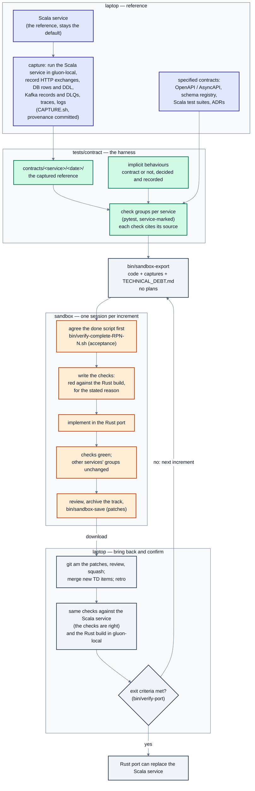

# Porting a service through contracts

How a Scala service is ported to Rust in gluon: the existing service's
behaviour is captured, turned into contract checks, and the port is built
until it passes the same checks.

## A short primer on contract testing

A **contract** is what other parts of the system may rely on about a service:
the requests it accepts and the answers it gives, the events it publishes and
consumes, the rows it writes, the telemetry it emits. Contract testing checks
that a service keeps its contract, by talking to it only through those
interfaces (black box): nothing in a check knows how the service is built.

Common forms:

- **Consumer-driven contracts** (e.g. Pact): each consumer records what it
  expects from a provider; the provider is checked against every consumer's
  expectations.
- **Specification contracts**: an OpenAPI or AsyncAPI document, or a schema
  registry entry, is the contract; responses and messages are validated
  against it.
- **Characterisation ("golden master") contracts**: the behaviour of a
  working implementation is recorded, and any new implementation must
  reproduce it.

Porting uses the last two together. The Scala service is the reference: its
recorded behaviour (the *capture*) and its specifications decide what the
port must do. A check is written from those sources, never from the port's
code, and names the source it came from.

Three rules make it work:

1. **Run the same checks against both implementations.** Green against the
   Scala service shows the check describes the reference; green against the
   port shows parity.
2. **See each check fail first, for the stated reason** (e.g. a 404 because
   the route doesn't exist yet). A check that has never failed may not be
   checking anything.
3. **Decide implicit behaviour explicitly.** A capture records everything,
   including accidents (header order, a hang while the database is paused).
   Each such behaviour is recorded as contract or not, so the port neither
   copies an accident nor drops something a consumer depends on.

What it doesn't cover: behaviour the capture never exercised, performance
under load, and internals (how the service stores or computes things), which
stay free to differ.

## The workflow

Source: [`contract-porting-workflow.mmd`](./contract-porting-workflow.mmd); image: [`contract-porting-workflow.svg`](./contract-porting-workflow.svg).

- **Laptop, reference:** the Scala service runs in gluon-local; a capture
  script records its behaviour, committed with its provenance to
  `tests/contract/contracts/<service>/<date>/`.
- **Harness:** `tests/contract` holds one check group per service, selected
  by `--service`; checks cite their capture file or specification.
- **Sandbox:** work happens in short sessions. Each starts by agreeing its
  acceptance script, writes the checks and sees them red, then implements
  until green, and ends saved as patches.
- **Laptop, bring back and confirm:** the patches are applied and reviewed;
  the checks run against the Scala service and against the port in
  gluon-local. The loop repeats until the port's exit criteria are met.
